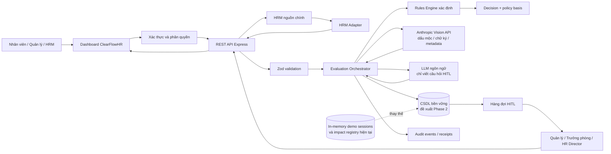
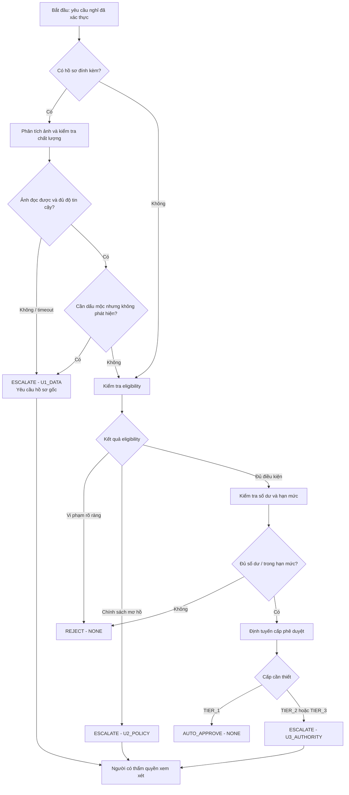
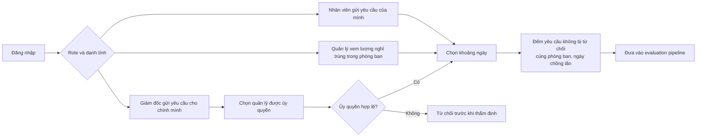
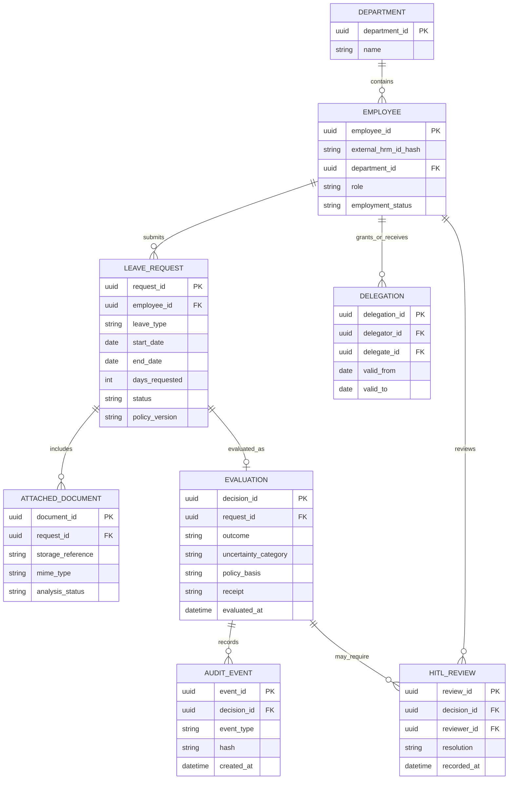
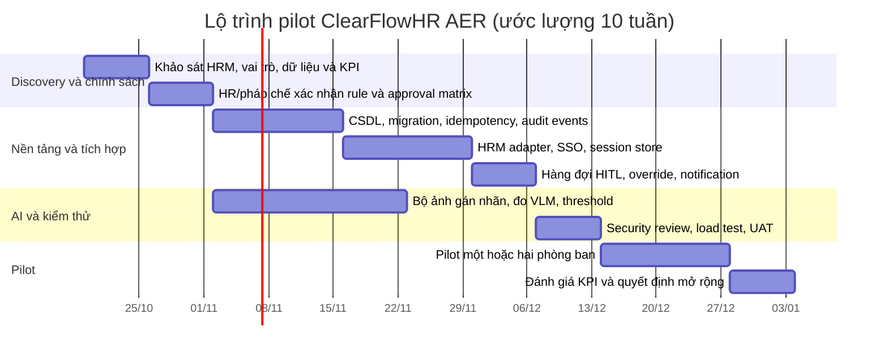

# ĐỀ XUẤT DỰ ÁN CLEARFLOWHR

## Hệ thống hỗ trợ thẩm định đơn nghỉ phép và chuyển cấp ngoại lệ (AER)

| Thuộc tính | Nội dung |
|---|---|
| Phiên bản tài liệu | 1.0 |
| Ngày lập | 17/10/2026 |
| Trạng thái | Đề xuất triển khai từ MVP sang pilot có kiểm soát |
| Đơn vị nghiệp vụ đề xuất | Nhân sự (HR) |
| Hệ thống | ClearFlowHR — Autonomous HR Escalation Referee (AER) |

> **Lưu ý:** Các điều khoản và ngưỡng trong mã hiện tại là quy tắc mẫu của MVP. HR và bộ phận pháp chế cần xác nhận chính sách có hiệu lực trước khi dùng để ra quyết định thật.

## 1. Tóm tắt điều hành

ClearFlowHR AER là middleware tiếp nhận yêu cầu nghỉ phép từ nhân viên hoặc HRM, kiểm tra dữ liệu đầu vào, áp dụng bộ quy tắc xác định để kiểm tra điều kiện, số dư và cấp phê duyệt, sau đó trả về một trong ba kết quả: tự động chấp thuận, từ chối theo quy tắc hoặc chuyển người có thẩm quyền xem xét.

Với hồ sơ y tế đính kèm, mô hình thị giác được dùng để đọc các thuộc tính nhìn thấy được như dấu mộc đỏ, chữ ký, ngày cấp và cơ sở cấp. Nếu tài liệu mờ, không đọc được hoặc dịch vụ AI không phản hồi đúng hạn, hệ thống chuyển sang `ESCALATE/U1_DATA`; hệ thống không được tự suy đoán dữ liệu còn thiếu. LLM chỉ được dùng để diễn đạt câu hỏi chuyển cấp, không tính số dư, diễn giải luật hoặc thay đổi quyết định đã được bộ quy tắc xác định.

MVP hiện đã có API Express, dashboard web, kiểm tra đầu vào bằng Zod, bộ quy tắc xác định, đăng nhập demo, thống kê yêu cầu nghỉ trùng trong phòng ban, xử lý tài liệu qua Anthropic Messages API của ShopAIKey và các bộ benchmark/smoke test. Tuy nhiên, trạng thái workflow, tài khoản, phiên đăng nhập và bộ đếm phòng ban còn lưu trong bộ nhớ; audit ledger và endpoint override chưa có lưu trữ bền vững. Vì vậy đề xuất này tập trung vào việc hoàn thiện nền tảng dữ liệu, quy trình HITL, tích hợp HRM, bảo mật và đánh giá chất lượng trước khi mở rộng người dùng.

## 2. Bối cảnh và vấn đề

Quy trình xin nghỉ thường cần kiểm tra nhiều nguồn: trạng thái việc làm, loại nghỉ, số dư, thời gian yêu cầu, hồ sơ hỗ trợ và cấp phê duyệt. Khi nhân viên hoặc quản lý kiểm tra thủ công, quy trình dễ gặp các vấn đề sau:

- Quy tắc được áp dụng không đồng nhất giữa phòng ban hoặc người xét duyệt.
- Hồ sơ y tế thiếu, mờ hoặc không có dấu xác nhận nhưng chỉ được phát hiện ở bước cuối.
- Quản lý khó đánh giá số lượng nhân viên trong cùng phòng ban nghỉ trùng thời gian.
- Quyết định thiếu lý do có cấu trúc, khó đối chiếu lại khi có khiếu nại.
- Hệ thống tự động hóa quá mức có thể đưa ra quyết định không an toàn nếu dữ liệu thiếu hoặc quy tắc không rõ.

AER giải quyết phần kiểm tra lặp lại bằng quy tắc minh bạch, đồng thời giữ quyết định của con người ở những trường hợp ngoại lệ, thẩm quyền cao hoặc độ tin cậy dữ liệu thấp.

## 3. Tầm nhìn và mục tiêu

### 3.1 Tầm nhìn

Xây dựng một lớp thẩm định có thể tích hợp với HRM, trả lời nhanh các trường hợp đơn giản, giải thích được căn cứ của quyết định và chuyển hồ sơ không chắc chắn tới đúng cấp phê duyệt.

### 3.2 Mục tiêu dự án

1. Chuẩn hóa quy trình đánh giá yêu cầu nghỉ bằng một hợp đồng API và bộ quy tắc có phiên bản.
2. Tự động xử lý các trường hợp đủ dữ liệu, đúng điều kiện và nằm trong thẩm quyền cho phép.
3. Chuyển hồ sơ thiếu dữ liệu, chính sách mơ hồ hoặc vượt cấp phê duyệt sang HITL.
4. Phân tích dấu mộc/chữ ký trên ảnh bằng Vision, với ngưỡng tin cậy và cơ chế fail-safe.
5. Cho phép nhân viên và quản lý đăng nhập; hỗ trợ xem ảnh hưởng của các yêu cầu nghỉ trùng trong phòng ban.
6. Lưu được quyết định, người xử lý, phiên bản quy tắc và biên nhận kiểm toán sau khi hoàn thiện Phase 2.

### 3.3 Ngoài mục tiêu

- Thay thế HRM, hệ thống chấm công, tính lương hoặc quản lý nhân sự tổng thể.
- Để LLM tự tính số dư, tự diễn giải luật lao động, tự xác định giới hạn thẩm quyền hoặc tự thay đổi kết quả của Rules Engine.
- Tự động chấp thuận một hồ sơ y tế chỉ dựa trên kết quả AI mà không có quy tắc và kiểm soát phù hợp.
- Cung cấp ý kiến tư vấn pháp lý.

## 4. Đối tượng sử dụng và bên liên quan

| Vai trò | Nhu cầu chính | Quyền/Trách nhiệm đề xuất |
|---|---|---|
| Nhân viên | Gửi yêu cầu, xem trạng thái và lý do | Tạo yêu cầu của chính mình; bổ sung hồ sơ khi được yêu cầu |
| Quản lý trực tiếp | Xem yêu cầu thuộc nhóm, xử lý trường hợp trong thẩm quyền | Xem xét hoặc chuyển cấp theo ma trận được HR phê duyệt |
| Trưởng phòng | Đánh giá yêu cầu vượt giới hạn của quản lý | Phê duyệt hoặc từ chối trong phạm vi thẩm quyền |
| HR Director | Xử lý hồ sơ nhạy cảm, dài ngày hoặc cần xác nhận chính sách | Quyết định các trường hợp cấp cao và ngoại lệ chính sách |
| HR Policy Owner | Quản lý chính sách và quy tắc | Phê duyệt nội dung, phiên bản và ngày hiệu lực của rule set |
| HRIS/IT | Tích hợp, vận hành và hỗ trợ | Quản lý tài khoản, kết nối HRM, môi trường triển khai |
| Bảo mật/Pháp chế | Quản lý dữ liệu sức khỏe, lưu trữ và nhà cung cấp AI | Rà soát quyền truy cập, retention, hợp đồng xử lý dữ liệu |

Mã nguồn hiện có ba role `EMPLOYEE`, `MANAGER`, `DIRECTOR`; danh sách tài khoản demo có 8 nhân viên, 1 quản lý và 1 giám đốc. Tài liệu README hiện mô tả 2 quản lý, nên cần đồng bộ số lượng và role demo trước khi phát hành tài liệu cho người dùng.

## 5. Phạm vi

### 5.1 Năng lực đã có trong MVP

- API `POST /api/v1/evaluate` kiểm tra payload bằng Zod và trả `AUTO_APPROVE`, `REJECT` hoặc `ESCALATE`.
- Rules Engine xác định kiểm tra điều kiện, số dư và cấp phê duyệt; AI không quyết định các trường này.
- VLM nhận ảnh JPEG/PNG/WebP, hỗ trợ đọc dấu mộc đỏ, chữ ký, ngày cấp và cơ sở cấp. PDF hiện được báo `UNSUPPORTED_FORMAT`.
- Tài liệu lỗi, không đủ độ tin cậy hoặc gọi model timeout dẫn tới `U1_DATA` và yêu cầu xét duyệt thủ công.
- LLM có thể viết lại câu hỏi chuyển cấp; nếu không dùng được LLM, hệ thống có câu hỏi mẫu dự phòng.
- Đăng nhập demo qua username/password; password được xác minh bằng scrypt; phiên dùng cookie `HttpOnly`, `SameSite=Lax`, thời hạn 8 giờ.
- Bộ đếm yêu cầu nghỉ trùng thời gian trong cùng phòng ban; tài khoản giám đốc gửi yêu cầu cho chính mình cần chỉ định quản lý ủy quyền.
- `GET /health`, `POST /api/v1/auth/login`, `GET /api/v1/auth/me`, `POST /api/v1/auth/logout`, `GET /api/v1/impact/`, `POST /api/v1/override`.
- Có bộ 15 benchmark case và 5 smoke case để kiểm tra hành vi nghiệp vụ mẫu.
- Có Dockerfile để đóng gói ứng dụng Node.js; frontend hiện dùng HTML/CSS/JavaScript thuần.

### 5.2 Phạm vi đề xuất cho pilot

- Chốt chính sách và ngưỡng phê duyệt với HR; chuyển các ngưỡng thành cấu hình có phiên bản và ngày hiệu lực.
- Tích hợp xác thực doanh nghiệp hoặc HRM; lấy trạng thái nhân viên, phòng ban, số dư từ nguồn đáng tin cậy.
- Lưu yêu cầu, kết quả, trạng thái HITL, ủy quyền và audit event vào cơ sở dữ liệu bền vững.
- Xây dựng hàng đợi xử lý cho người duyệt, nhắc việc và cập nhật trạng thái cho HRM.
- Định nghĩa quy trình idempotency, chống gửi trùng và đồng bộ kết quả chấp thuận về HRM.
- Tạo bộ ảnh được gán nhãn để đánh giá nhận diện dấu mộc; theo dõi precision, recall, confidence và tỷ lệ chuyển người.
- Thiết lập log vận hành đã khử PII, giám sát lỗi, độ trễ, quota và trạng thái nhà cung cấp AI.
- Pilot có kiểm soát tại một hoặc hai phòng ban trước khi mở rộng.

### 5.3 Ngoài phạm vi pilot

- Tính lương, tính thuế, chấm công hoặc tự động cập nhật ngày công.
- OCR mọi định dạng tài liệu và mọi biểu mẫu không có bộ dữ liệu đánh giá.
- Tự động đưa ra quyết định pháp lý hoặc thay thế phán đoán của HR.
- Tự động khấu trừ/ghi sổ số dư nghỉ nếu HRM chưa cung cấp API giao dịch và cơ chế hoàn tác.

## 6. Quy tắc nghiệp vụ hiện tại

Các bảng dưới đây mô tả logic đang có trong mã; HR cần xác nhận từng mục trước pilot. Tên điều khoản là tham chiếu cấu hình nội bộ trong MVP, không phải xác nhận pháp luật.

### 6.1 Ma trận eligibility

| Trạng thái | Nghỉ năm | Nghỉ ốm | Thai sản | Nghỉ khi vợ sinh | Không lương | Việc riêng |
|---|---|---|---|---|---|---|
| CONFIRMED | Đủ điều kiện | Đủ điều kiện | Đủ điều kiện | Đủ điều kiện | Đủ điều kiện | Đủ điều kiện |
| PROBATION | Từ chối theo rule mẫu | Đủ điều kiện | Chuyển HR (`U2_POLICY`) | Chuyển HR (`U2_POLICY`) | Đủ điều kiện | Đủ điều kiện |
| CONTRACT | Đủ điều kiện | Đủ điều kiện | Chuyển HR (`U2_POLICY`) | Chuyển HR (`U2_POLICY`) | Đủ điều kiện | Đủ điều kiện |
| RESIGNED | Từ chối | Từ chối | Từ chối | Từ chối | Từ chối | Từ chối |

### 6.2 Kiểm tra số dư và hạn mức trong code

| Loại nghỉ | Cách kiểm tra hiện tại |
|---|---|
| ANNUAL | So sánh ngày yêu cầu với `annual_days_remaining` do caller gửi |
| SICK | So sánh ngày yêu cầu với `sick_days_remaining` do caller gửi |
| MATERNITY | Đổi tuần còn lại sang ngày; chặn yêu cầu vượt 26 tuần mỗi sự kiện |
| PATERNITY | Giới hạn 14 ngày mỗi sự kiện |
| COMPASSIONATE | Giới hạn 5 ngày mỗi sự kiện |
| UNPAID | Không đặt trần số dư trong checker; ghi nhận tổng ngày đã dùng trong năm |

MVP chưa giữ snapshot số dư ở phía server và chưa khấu trừ số dư sau khi duyệt. HRM phải tiếp tục là nguồn dữ liệu chính thức.

### 6.3 Phân cấp phê duyệt hiện tại

| Tình huống | Cấp trong rule engine | Kết quả mặc định |
|---|---|---|
| Tối đa 5 ngày, loại nghỉ thông thường | Quản lý trực tiếp | Có thể `AUTO_APPROVE` nếu các bước khác đạt |
| 6–14 ngày hoặc PATERNITY | Trưởng phòng (`TIER_2`) | `ESCALATE/U3_AUTHORITY` |
| Trên 14 ngày | HR Director (`TIER_3`) | `ESCALATE/U3_AUTHORITY` |
| MATERNITY | HR Director (`TIER_3`) | `ESCALATE/U3_AUTHORITY` |

Trong mã nguồn, PATERNITY từ 14 ngày trở xuống yêu cầu ít nhất `TIER_2`; README có chỗ mô tả PATERNITY luôn cần HR Director. HR cần chốt quy tắc chính xác, sau đó đồng bộ mã, README, benchmark và quy trình ủy quyền.

## 7. Kiến trúc đề xuất

### 7.1 Sơ đồ thành phần



### 7.2 Luồng xử lý một yêu cầu

```mermaid
sequenceDiagram
    autonumber
    actor E as Nhân viên hoặc HRM
    participant A as AER API
    participant V as Anthropic Vision
    participant R as Rules Engine
    participant L as Anthropic Language
    participant H as Người duyệt
    participant D as CSDL/Audit (mục tiêu)

    E->>A: POST /api/v1/evaluate
    A->>A: Xác thực, kiểm tra Zod, idempotency
    opt Có tài liệu ảnh
        A->>V: Phân tích ảnh Base64
        V-->>A: Dấu mộc, chữ ký, ngày/cơ sở, confidence
    end
    A->>R: Kiểm tra eligibility, balance, authority
    alt Thiếu dữ liệu hoặc VLM lỗi/độ tin cậy thấp
        R-->>A: ESCALATE / U1_DATA
    else Chính sách mơ hồ
        R-->>A: ESCALATE / U2_POLICY
    else Vượt thẩm quyền
        R-->>A: ESCALATE / U3_AUTHORITY
    else Vi phạm rule xác định
        R-->>A: REJECT / NONE
    else Đạt toàn bộ điều kiện
        R-->>A: AUTO_APPROVE / NONE
    end
    opt Kết quả ESCALATE
        A->>L: Viết lại câu hỏi đã được Rules Engine quyết định
        L-->>A: Câu hỏi HITL; không thay đổi quyết định
        A-->>H: Đưa vào hàng đợi cần xem xét
        H->>A: POST /api/v1/override
    end
    A->>D: Lưu quyết định, reviewer, rule version và receipt
    A-->>E: Kết quả + căn cứ + receipt
```

> Trong MVP, `workflow.ts` chưa lưu trạng thái HITL; endpoint override là stub và hàm append audit chưa ghi dữ liệu bền vững. Các bước có nhãn “mục tiêu” cần hoàn thành trước khi coi đây là quy trình vận hành production.

### 7.3 Sơ đồ quyết định



### 7.4 Đánh giá ảnh hưởng phòng ban và ủy quyền



Đếm yêu cầu trùng hiện là chỉ số vận hành, không phải yếu tố tự động cộng/trừ điểm quyết định. Phase tiếp theo có thể bổ sung ngưỡng cảnh báo theo số người nghỉ trùng, nhưng mọi thay đổi ảnh hưởng quyết định phải được HR phê duyệt và triển khai bằng rule xác định.

### 7.5 Mô hình dữ liệu logic mục tiêu



Đây là mô hình đề xuất, không phản ánh cơ sở dữ liệu đang chạy. MVP hiện chưa sử dụng CSDL quan hệ hay object storage.

## 8. Yêu cầu chức năng

| Mã | Yêu cầu |
|---|---|
| FR-01 | Nhận yêu cầu nghỉ có mã nhân viên đã băm, loại nghỉ, ngày, số ngày, trạng thái làm việc và snapshot số dư. |
| FR-02 | Từ chối payload sai schema; mọi dữ liệu đầu vào API phải được validate bằng Zod. |
| FR-03 | Kiểm tra eligibility bằng ma trận xác định, trả căn cứ rule và mã uncertainty tương ứng. |
| FR-04 | Kiểm tra số dư/hạn mức bằng phép tính xác định; không gọi LLM cho phép tính này. |
| FR-05 | Định tuyến thẩm quyền theo ngày nghỉ, loại nghỉ và rule set có phiên bản. |
| FR-06 | Phân tích ảnh đính kèm; lỗi/timeout/độ tin cậy thấp phải chuyển `U1_DATA`. |
| FR-07 | Sinh câu hỏi đóng cho reviewer; giữ nguyên outcome, uncertainty và policy basis đã quyết định. |
| FR-08 | Hiển thị số yêu cầu nghỉ trùng trong phòng ban theo khoảng ngày; phân biệt số liệu ước tính và quyết định. |
| FR-09 | Xác minh delegate hợp lệ khi giám đốc gửi yêu cầu cá nhân. |
| FR-10 | Cho reviewer được phân quyền xử lý ESCALATE: approve, reject hoặc chuyển loại nghỉ theo policy. |
| FR-11 | Lưu lịch sử request, decision, override và receipt; chống ghi lặp bằng `request_id`/idempotency key. |
| FR-12 | Đồng bộ kết quả cuối cùng về HRM và ghi nhận lỗi đồng bộ để có thể retry an toàn. |

## 9. Yêu cầu phi chức năng

| Nhóm | Mục tiêu đề xuất |
|---|---|
| An toàn quyết định | Không fail-open; bất kỳ lỗi dữ liệu/model nào cũng đi theo nhánh escalate hoặc lỗi nghiệp vụ được định nghĩa. |
| Tính giải thích | Mỗi kết quả trả outcome, uncertainty category, policy basis, thời gian và receipt. |
| Độ trễ | Bộ xử lý rule xác định nội bộ có mục tiêu p95 dưới 10 ms khi không gọi dịch vụ ngoài; thời gian end-to-end có AI/HRM đo riêng, mục tiêu VLM p95 dưới 30 giây trong pilot. |
| Timeout | Đặt hard timeout tối đa 60 giây cho AI; hết thời gian thì chuyển `U1_DATA` hoặc dùng template fallback. |
| Tính sẵn sàng | Pilot mục tiêu 99.5%/tháng, loại trừ bảo trì đã thông báo; production cần chốt theo SLA HRM. |
| Mở rộng | API stateless, session và job state được lưu ngoài bộ nhớ tiến trình để hỗ trợ nhiều replica. |
| Bảo mật | TLS, least privilege, rate limiting, secret manager, audit access, mã hóa dữ liệu nhạy cảm khi lưu. |
| Khả năng quan sát | Metrics về latency, timeout, model status, decision distribution và HITL queue; log không chứa PII thô. |
| Khả năng truy cập | Dashboard sử dụng được trên desktop và thiết bị di động; hỗ trợ keyboard và thông báo lỗi rõ ràng. |
| Khôi phục | Sao lưu CSDL và hồ sơ theo RPO/RTO được thống nhất; kiểm thử khôi phục định kỳ. |

Các con số trên là mục tiêu đề xuất để thống nhất trong giai đoạn discovery, không phải SLA hiện hữu.

## 10. Tích hợp và giao diện API

| API | Mục đích | Trạng thái |
|---|---|---|
| `GET /health` | Kiểm tra tiến trình ứng dụng | Đã có |
| `POST /api/v1/auth/login` | Đăng nhập demo | Đã có; tài khoản cần chuyển sang SSO/HRM cho production |
| `GET /api/v1/auth/me` | Lấy session hiện tại | Đã có |
| `POST /api/v1/auth/logout` | Kết thúc session | Đã có |
| `POST /api/v1/evaluate` | Thẩm định yêu cầu nghỉ | Đã có; cần idempotency, DB và adapter HRM |
| `GET /api/v1/impact/` | Đếm yêu cầu nghỉ trùng | Đã có; hiện in-memory và chỉ bao phủ dữ liệu đã ghi nhận trong tiến trình |
| `POST /api/v1/override` | Ghi resolution của reviewer | Có endpoint stub; chưa có trạng thái HITL bền vững |

### Luồng tích hợp HRM đề xuất

1. HRM gửi request có `request_id` duy nhất, dữ liệu nhân viên/số dư lấy từ nguồn chính thức và `attached_documents` nếu có.
2. AER xác thực caller, kiểm tra schema và chống xử lý trùng.
3. AER trả kết quả đồng bộ cho trường hợp thuần rule; hồ sơ có AI/HITL có thể chuyển thành job bất đồng bộ nếu SLA HRM không cho phép chờ.
4. AER phát webhook hoặc HRM polling trạng thái để nhận kết quả cuối cùng.
5. Sau khi con người duyệt, AER ghi resolution và HRM cập nhật phép; việc cập nhật phải có xác nhận giao dịch và cơ chế retry idempotent.

## 11. Bảo mật, quyền riêng tư và quản trị AI

- Dữ liệu hồ sơ y tế là dữ liệu nhạy cảm. Trước khi gửi tới ShopAIKey, cần HR/pháp chế phê duyệt nhà cung cấp, mục đích xử lý, khu vực lưu trữ, retention, điều kiện xóa và thỏa thuận xử lý dữ liệu.
- Chỉ gửi trường dữ liệu cần thiết. LLM viết câu hỏi không cần nhận tên thật; đề xuất thay tên bằng mã tạm trong prompt rồi thay thế cục bộ sau khi nhận kết quả.
- Không ghi ảnh, base64, password, API key hoặc thông tin nhân viên nguyên văn vào log. Log cần dùng ID đã băm hoặc request UUID.
- Sử dụng secret manager hoặc Docker/Kubernetes secrets; hỗ trợ luân chuyển key. Không đưa `.env` vào image hoặc kho mã.
- Demo hiện dùng session lưu trong bộ nhớ. Production cần session store bền vững, CSRF protection phù hợp, SSO/MFA theo chính sách doanh nghiệp và timeout phiên có thể cấu hình.
- Rate limit đăng nhập hiện là giới hạn tiến trình; production cần giới hạn dùng chung giữa các replica và khóa/mở theo chính sách.
- Quyền reviewer phải kiểm tra trên server theo role, department, cấp phê duyệt, thời hạn delegate và quyền truy cập hồ sơ.
- VLM chỉ cung cấp thuộc tính nhìn thấy được. Kết quả không đủ độ tin cậy hoặc không nhận diện được dấu phải vào hàng đợi người xem xét.
- Trước pilot, lập bộ dữ liệu đã gán nhãn cho dấu mộc đỏ; đo false positive/false negative theo loại tài liệu, chất lượng ảnh và nhà cung cấp/model.
- Quy tắc phải có `policy_version`, người phê duyệt, ngày hiệu lực và bộ test hồi quy tương ứng.

## 12. Lộ trình triển khai đề xuất

Lộ trình dưới đây là ước lượng 10 tuần, giả định một nhóm nhỏ chuyên trách và HR cung cấp người duyệt chính sách. Ngày bắt đầu thực tế cần được thống nhất sau khi duyệt đề xuất.



### Cổng nghiệm thu theo giai đoạn

| Giai đoạn | Tiêu chí qua cổng |
|---|---|
| Discovery | HR ký rule matrix, định nghĩa role/delegate, chủ sở hữu dữ liệu và quy trình xử lý hồ sơ y tế |
| Nền tảng | Tái khởi động không làm mất session/job/impact state; request lặp không tạo quyết định trùng |
| Tích hợp | HRM test end-to-end, rollback/retry không khấu trừ số dư hai lần |
| AI | Có báo cáo đánh giá trên bộ ảnh đại diện, ngưỡng chuyển người được HR duyệt |
| Pilot | Không có fail-open; mọi override có reviewer, thời gian, lý do và audit event |
| Mở rộng | KPI đạt mục tiêu trong pilot và có phê duyệt vận hành/bảo mật |

## 13. Nguồn lực và trách nhiệm

### 13.1 Nhóm tối thiểu đề xuất

| Vai trò | Khối lượng tham khảo | Trách nhiệm |
|---|---:|---|
| Product Owner/HR | 0.5–1 FTE | Ưu tiên, quy trình, nghiệm thu nghiệp vụ |
| HR Policy Owner/Pháp chế | 0.25–0.5 FTE | Xác nhận rule, quyền phê duyệt, nội dung thông báo |
| Business Analyst | 1 FTE | Đặc tả use case, mapping HRM và acceptance criteria |
| Tech Lead/Backend | 1 FTE | Kiến trúc, API, Rules Engine, HRM integration |
| Backend Engineer | 1 FTE | Persistence, queue, audit, auth |
| Frontend Engineer | 1 FTE | Dashboard, hàng đợi HITL, trạng thái và accessibility |
| QA Engineer | 1 FTE | Benchmark, regression, integration và UAT |
| DevOps/Security | 0.5 FTE | Secrets, pipeline, monitoring, backup, security review |

### 13.2 RACI tóm tắt

| Hạng mục | HR | Pháp chế/Bảo mật | Product/BA | Engineering | QA/DevOps |
|---|---|---|---|---|---|
| Rule và authority matrix | A/R | C | R | C | I |
| Data mapping/HRM contract | C | C | A/R | R | C |
| Kiến trúc và phát triển | C | C | A | R | C |
| Đánh giá VLM | A | C | C | R | R |
| Security/retention | C | A/R | I | R | R |
| Pilot và nghiệm thu | A/R | C | R | C | R |

`R` = thực hiện, `A` = chịu trách nhiệm cuối, `C` = tham vấn, `I` = được thông báo.

## 14. KPI và tiêu chí nghiệm thu đề xuất

| KPI | Mục tiêu pilot đề xuất | Cách đo |
|---|---:|---|
| Độ chính xác của quyết định xác định | 100% khớp bộ test được HR duyệt | Benchmark theo từng phiên bản rule |
| Fail-open do lỗi AI/dữ liệu | 0 trường hợp | Kiểm tra log và quyết định trên các lỗi inject |
| Đầy đủ audit event ở production | 100% quyết định và override | Đối chiếu API response với DB/ledger |
| Thời gian xử lý thuần rule | p95 < 100 ms, chưa tính mạng HRM | Distributed tracing |
| Thời gian VLM | p95 < 30 giây trong pilot | Metrics server-side, không log ảnh |
| Chất lượng dấu mộc | Ngưỡng precision/recall do HR chốt trước pilot | Bộ dữ liệu có nhãn và đánh giá độc lập |
| Tỷ lệ timeout model | Theo dõi giảm dần; ngưỡng cảnh báo được chốt với nhà cung cấp | Metrics theo model/endpoint |
| Tỷ lệ escalations đúng cấp | ≥ 99% trên benchmark đã phê duyệt | Phân tích uncertainty category và reviewer queue |
| Tỷ lệ yêu cầu trùng | Giảm so với baseline quy trình thủ công | Đo trong pilot theo phòng ban |
| Trải nghiệm người dùng | CSAT mục tiêu ≥ 4/5 | Khảo sát nhân viên và reviewer sau pilot |

Các KPI AI là mục tiêu cần xác nhận sau khi có bộ dữ liệu thật đã được phê duyệt; không dùng một con số chưa đánh giá làm cam kết hiệu năng.

## 15. Rủi ro và phương án giảm thiểu

| Rủi ro | Tác động | Giảm thiểu |
|---|---|---|
| Rule mẫu không trùng chính sách doanh nghiệp | Chấp thuận/từ chối sai | HR/pháp chế ký rule matrix; version hóa; chạy regression trước phát hành |
| Sai lệch giữa code và tài liệu approval | Định tuyến sai reviewer | Đồng bộ rule, README, benchmark; policy owner duyệt thay đổi |
| VLM bỏ sót dấu hoặc nhận nhầm hình đỏ | Escalate thừa hoặc xác minh sai hồ sơ | Bộ ảnh có nhãn, confidence threshold, human review, theo dõi precision/recall |
| API chậm/không khả dụng | Tăng thời gian phản hồi, backlog | Timeout cấu hình được, queue bất đồng bộ, retry có giới hạn, fail-safe U1_DATA |
| Dữ liệu y tế gửi ra ngoài doanh nghiệp | Rủi ro riêng tư/tuân thủ | Rà soát vendor, DPA, data minimization, retention, thông báo và phê duyệt |
| Snapshot số dư lỗi thời | Quyết định dựa trên số dư cũ | HRM là source of truth; kiểm tra lại trước khi commit; idempotent write-back |
| Dữ liệu in-memory mất khi restart | Mất session, counter, trạng thái | CSDL/session store/queue bền vững và backup |
| Tài khoản demo dùng trong production | Truy cập trái phép | Thay bằng SSO, bỏ credential demo khỏi image, quản lý vòng đời tài khoản |
| Receipt bị hiểu là audit ledger đầy đủ | Không truy vết được lịch sử | Triển khai append-only ledger, lưu rule version và actor, xác minh receipt định kỳ |
| Phụ thuộc một nhà cung cấp/model | Downtime hoặc thay đổi model | Adapter provider, model pinning, canary/evaluation trước khi đổi model |
| Gửi trùng hoặc retry không an toàn | Ghi nhận/khấu trừ lặp | Idempotency key, unique constraint, transactional outbox và reconciliation |

## 16. Chi phí và mô hình ước lượng

Chưa thể đưa ra tổng ngân sách đáng tin cậy khi chưa biết lượng yêu cầu, độ dài ảnh, lưu trữ, số lượng người dùng và biểu phí hợp đồng của nhà cung cấp. Đề xuất lập ngân sách theo các cấu phần sau:

1. **Nhân sự:** discovery, phát triển, QA, security, triển khai và hỗ trợ pilot.
2. **Hạ tầng:** ứng dụng, CSDL, object storage hồ sơ, queue, backup, monitoring và môi trường staging.
3. **API AI:** số request VLM, kích thước ảnh/token đầu vào, token sinh câu hỏi, retry và chi phí model dự phòng.
4. **Bảo mật/tuân thủ:** SSO, secret manager, kiểm thử xâm nhập, lưu trữ/log, đánh giá vendor và hợp đồng dữ liệu.
5. **Vận hành:** hỗ trợ HR, xử lý escalations, xem lại nhãn ảnh và cập nhật rule.

Sau discovery, cần lập kịch bản thấp/cơ sở/cao theo công thức: `chi phí tháng = chi phí cố định hạ tầng + số request từng loại × đơn giá thực tế + lưu trữ/egress + vận hành`.

## 17. Giả định và quyết định cần chốt

Trước khi lập kế hoạch chi tiết, sponsor và HR cần xác nhận:

1. HRM nào là nguồn chính thức của trạng thái nhân viên và số dư nghỉ; có API đọc/ghi hay chỉ export?
2. Đơn vị tính ngày nghỉ là ngày làm việc hay ngày lịch; ngày lễ/cuối tuần xử lý ở đâu?
3. Ma trận chính sách chính thức, ngưỡng theo loại nghỉ, và quy tắc đặc biệt cho probation/contract/resigned.
4. PATERNITY cần Trưởng phòng hay HR Director ở từng trường hợp? Tài liệu hiện tại và code chưa hoàn toàn đồng nhất.
5. Ai được duyệt từng tier, ai là delegate, quyền delegate có hiệu lực theo thời hạn nào?
6. Có cho phép gửi ảnh y tế tới ShopAIKey không; retention và vùng xử lý dữ liệu nào được chấp nhận?
7. Pilot chạy ở phòng ban nào, bao nhiêu nhân viên, trong bao lâu và ai là HR reviewer?
8. Cần đồng bộ kết quả về HRM theo API, webhook hay file; hành vi khi HRM tạm ngừng?
9. SLA cho phản hồi người dùng, hàng đợi HITL, thời gian lưu hồ sơ và quy trình xóa dữ liệu?
10. Danh sách tài khoản demo chính xác là 8 nhân viên + 1 quản lý + 1 giám đốc hay 8 nhân viên + 2 quản lý như README mô tả?

## 18. Kết luận và đề nghị phê duyệt

ClearFlowHR AER có nền tảng phù hợp để giảm thao tác kiểm tra lặp lại trong quy trình nghỉ phép: Rules Engine xác định, phân loại uncertainty rõ ràng, hỗ trợ đánh giá ảnh và có điểm chuyển cho người duyệt. MVP cũng đã thể hiện được API, dashboard, demo login và benchmark ban đầu.

Đề nghị phê duyệt **giai đoạn discovery và hardening trước pilot**, với các điều kiện:

- HR/pháp chế xác nhận rule matrix và cấp phê duyệt trước khi bật tự động hóa.
- Hoàn thiện DB, audit persistence, trạng thái HITL và kết nối HRM trước khi dùng dữ liệu thật.
- Đánh giá bảo mật/riêng tư đối với hồ sơ y tế và nhà cung cấp AI.
- Chạy pilot theo chế độ có người giám sát; mọi timeout, dữ liệu mờ hoặc không chắc chắn phải chuyển sang người xử lý.
- Chỉ mở rộng khi acceptance criteria và KPI được sponsor phê duyệt.

Quyết định cần đưa ra ở bước tiếp theo: **chọn sponsor nghiệp vụ, chốt HRM/source of truth, phê duyệt chính sách và xác định phòng ban pilot**.
